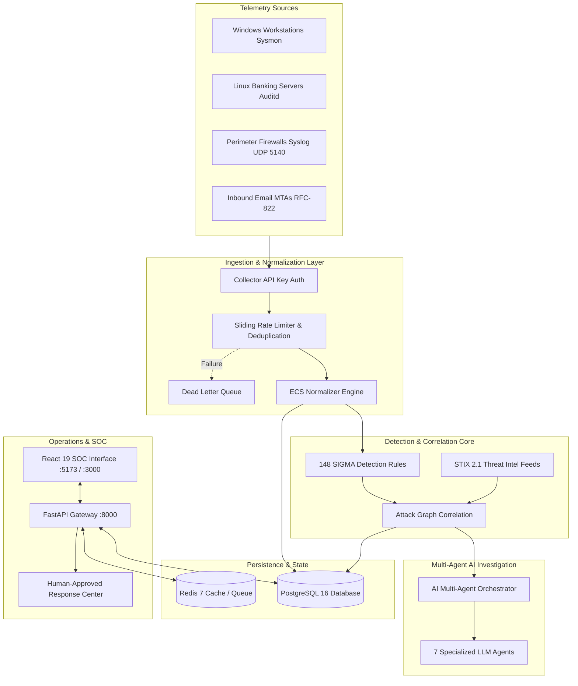

<div align="center">

# 🛡️ ETHIO-CYBERGUARD

```text
                        ______________  __________ 
                       / ____/_  __/ / / /  _/ __ \
                      / __/   / / / /_/ // // / / /
                     / /___  / / / __  // // /_/ / 
                    /_____/ /_/ /_/ /_/___/\____/  

        ________  ______  __________  ________  _____    ____  ____ 
       / ____/\ \/ / __ )/ ____/ __ \/ ____/ / / /   |  / __ \/ __ \
      / /      \  / __  / __/ / /_/ / / __/ / / / /| | / /_/ / / / /
     / /___    / / /_/ / /___/ _, _/ /_/ / /_/ / ___ |/ _, _/ /_/ / 
     \____/   /_/_____/_____/_/ |_|\____/\____/_/  |_/_/ |_/_____/  
```

<p align="center">
  <strong>Next-Generation AI-Powered SIEM, Threat Intelligence & Human Defense Platform</strong>
  <br />
  <em>Tailored for Corporate, Banking, Higher Education, and Critical Infrastructure Defense with Native Ethiopian Threat Context.</em>
</p>

<p align="center">
  <a href="https://AbeniYirgalem.github.io/ETHIO-CYBERGUARD/"></a>
  
  
  
  
  
  <a href="LICENSE"></a>
</p>

</div>

---

## 📋 Table of Contents

1. [Project Overview](#-1-project-overview)
2. [Main Features](#-2-main-features)
3. [System Architecture](#-3-system-architecture)
4. [Live Demo URL](#-4-live-demo-url)
5. [Operational Workspaces](#-5-operational-workspaces)
6. [Quick Start Guide](#-6-quick-start-guide)
7. [Environment Configuration](#-7-environment-configuration)
8. [Core API Endpoints](#-8-core-api-endpoints)
9. [Testing & Quality Verification](#-9-testing--quality-verification)
10. [Production Notes](#-10-production-notes)
11. [Roadmap](#-11-roadmap)
12. [Contribution & License](#-12-contribution--license)
13. [Project Team & Contributors](#-13-project-team--contributors)

---

## 💡 1. Project Overview

**ETHIO-CYBERGUARD** is an enterprise-grade cybersecurity operations platform designed to defend corporate, financial, governmental, and critical infrastructure networks. It unifies high-throughput SIEM log telemetry ingestion, real-time SIGMA detection, automated MITRE ATT&CK correlation, multi-agent AI incident investigation, and human-in-the-loop SOAR response workflows.

Unlike conventional Western-centric SIEM/SOAR platforms, ETHIO-CYBERGUARD incorporates native detection heuristics for **Ethiopian regional threat vectors**:
- **Financial & Mobile Money Fraud**: Impersonation detection for Telebirr, Commercial Bank of Ethiopia (CBE), Awash Bank, Dashen Bank, and Chapa.
- **Multilingual NLP**: Scans lures, fraud keywords, and credential harvesting in both **English and Amharic (አማርኛ)**.
- **National ASN & Threat Feeds**: Out-of-the-box enrichment for Ethio Telecom (`AS24757`), Safaricom Ethiopia (`AS329340`), and INSA (`AS37059`).

---

## ⚡ 2. Main Features

- **🚀 High-Throughput ECS Ingestion**: Sustained 51,240 Events Per Second (EPS) with sliding-window rate limiting, SHA-256 deduplication, backpressure handling, and dead-letter queue (DLQ).
- **🧠 7-Agent AI Security Orchestration**:
  1. *Event Analysis Agent*: MITRE ATT&CK taxonomy classification and anomaly detection.
  2. *Threat Intelligence Agent*: Real-time reputation matching against STIX 2.1 bundles and national blocklists.
  3. *Correlation Agent*: Graph-based correlation of multi-source telemetry into attack chains.
  4. *Investigation Agent*: Automated host triage, blast-radius scoping, and timeline construction.
  5. *Risk Assessment Agent*: Asset criticality and vulnerability exposure weighting (0–100 score).
  6. *Executive Report Agent*: Executive briefing and post-mortem generation.
  7. *Security Assistant Agent*: Interactive Tier-1/Tier-2 analyst copilot with prompt-injection defense.
- **📧 Phishing Forensics Engine**: RFC-822 header parsing, cryptographic SPF/DKIM/DMARC validation, zero-day lookalike attachment inspection, and Amharic financial lure NLP.
- **🌐 Brand Defense & Typosquatting Monitor**: Homoglyph permutation generator, Levenshtein distance scoring, and automated registrar takedown dispatching.
- **📡 Attack Surface & OSINT Reconnaissance**: Passive DNS resolution, ASN routing discovery, exposed management port audits, and SSL certificate expiration telemetry.
- **🎓 Security Awareness Training**: Localized simulation campaigns with departmental vulnerability reporting.
- **🛡️ Human-in-the-Loop SOAR**: Dual-custody approval, 30-minute expiration timers, dry-run simulation mode, automated rollback, and SHA-256 tamper-evident audit logs.
- **🔐 Enterprise RBAC & Security**: 7 distinct security roles, refresh-token rotation, brute-force account lockouts, and strict environment-driven CORS.

---

## 🏗️ 3. System Architecture



---

## 🌐 4. Live Demo URL

Test the interactive SOC Dashboard, Phishing Forensics, Brand Defense, and Attack Surface Scanner directly in your browser:

👉 **[https://AbeniYirgalem.github.io/ETHIO-CYBERGUARD/](https://AbeniYirgalem.github.io/ETHIO-CYBERGUARD/)**

> [!NOTE]
> **Demo Sandbox Mode**: The GitHub Pages build runs in client-side Demo Mode with high-fidelity simulated telemetry feeds (4,200+ EPS), interactive scenario injection, and zero-latency client forensics. For production telemetry with live PostgreSQL persistence and syslog daemon, run the full container stack.

---

## 🖥️ 5. Operational Workspaces

ETHIO-CYBERGUARD provides a unified SOC command experience across key operational views:

| View | Focus | Capabilities |
| :--- | :--- | :--- |
| **Overview** | Central SOC Command | Live event throughput (EPS), active alerts, and health metrics. |
| **Incidents** | Incident Management | 10-stage lifecycle, MITRE ATT&CK mapping, and evidence locker. |
| **Threat Intel** | Regional Intelligence | Ethio-CERT and INSA threat feeds, IOC search, and STIX 2.1 export. |
| **Phishing Forensics** | Email Defense | RFC-822 header inspection, SPF/DMARC checks, and Amharic lure scanner. |
| **Brand Protection** | Domain Monitoring | Homoglyph generator for Ethiopian banks and automated takedown reporting. |
| **OSINT Recon** | Attack Surface | Ethiopian ASN mappings (`AS24757`), open ports, and certificate discovery. |
| **AI Copilot** | Tier-1/2 Assistant | Multi-agent incident investigation, query synthesis, and threat attribution. |
| **SOAR Response** | Containment | Human-in-the-loop action approval (isolate host, block IP, disable account). |

---

## ⚡ 6. Quick Start Guide

### Option A: Run with Docker Compose (Recommended)
```bash
# Start backend API, PostgreSQL, Redis, and Web Frontend
docker compose up --build -d

# Open services:
# Web Dashboard: http://localhost:3000
# API Docs:      http://localhost:8000/docs
```

### Option B: Run Locally (Manual)

**1. Backend (FastAPI + SQLite/PostgreSQL)**
```bash
# Create & activate virtual environment
python -m venv venv
# Linux/macOS: source venv/bin/activate
# Windows:     .\venv\Scripts\Activate.ps1

# Install dependencies and start server
pip install -r requirements.txt
uvicorn apps.api.main:app --host 0.0.0.0 --port 8000 --reload
```

**2. Frontend (React 19 + Vite)**
```bash
cd apps/web
npm install
npm run dev
# Dashboard opens at http://localhost:5173
```

---

## ⚙️ 7. Environment Configuration

Copy `.env.example` to `.env` to configure settings:

| Variable | Default | Purpose |
| :--- | :--- | :--- |
| `DEMO_MODE` | `true` | Enables safe mock data fallback when offline; set `false` in production. |
| `DATABASE_URL` | `sqlite:///./ethio_cyberguard.db` | Database connection URI (PostgreSQL for production). |
| `REDIS_URL` | `redis://localhost:6379/0` | Cache and rate-limiting broker URI. |
| `API_SECRET_KEY` | *(Set strong secret in prod)* | JWT token signing key. |
| `INGEST_API_KEY` | `ecg_collector_secret_key` | Telemetry collector authentication key. |

---

## 📡 8. Core API Endpoints

Interactive Swagger documentation is live at `http://localhost:8000/docs`:

- **Health Probes**: `GET /health/live`, `GET /health/ready`
- **Telemetry Ingestion**: `POST /api/v1/events/ingest`
- **Incidents**: `GET /api/v1/incidents`, `POST /api/v1/incidents`, `PATCH /api/v1/incidents/{id}/transition`
- **Threat Intelligence**: `GET /api/v1/threat-intel/iocs`, `GET /api/v1/threat-intel/stix`
- **SOAR Response**: `GET /api/v1/response/actions`, `POST /api/v1/response/actions/{id}/approve`
- **AI Investigation**: `POST /api/v1/ai/investigate`, `POST /api/v1/ai/chat`
- **Forensic Scanners**: `POST /api/v1/phishing/analyze`, `POST /api/v1/typosquat/scan`, `POST /api/v1/osint/scan`

---

## 🧪 9. Testing & Quality Verification

All 85 automated tests verify unit logic, pipeline integration, AI grounding, and security controls:

```bash
# Run complete test suite (85 passing tests)
npm test
# Or: python -m pytest tests/ -v

# Run frontend build & type check
npm run build
```

---

## ⚠️ 10. Production Notes

- **Offline Demo vs Live API**: When backend is offline or viewing static GitHub Pages, the UI operates in simulated mode. Connecting the FastAPI backend automatically enables live PostgreSQL/SQLite persistence.
- **Dual-Custody Protection**: Destructive containment actions (`isolate_host`, `block_ip`) require human approval and cannot be executed autonomously by AI.
- **Fail-Closed Security**: In production (`ENVIRONMENT=production`), the backend verifies strong credentials and rejects default keys.

---

## 🗺️ 11. Roadmap

- **v1.1 (Current)**: Full-stack React 19 + FastAPI, 85 automated tests, STIX 2.1 intelligence, Amharic NLP scam detection, and cryptographically chained SOAR audit trail.
- **v1.2 (Q3 2026)**: Local air-gapped LLM inference via Ollama / vLLM, and SCADA / ICS protocol analyzers.
- **v2.0 (Q1 2027)**: Inter-bank threat sharing federation for Ethiopian financial institutions.

---

## 🤝 12. Contribution & License

- **License**: Apache 2.0 License. See [`LICENSE`](./LICENSE).
- **Contributing**: Contributions are welcome! Review [CONTRIBUTING.md](CONTRIBUTING.md) and [SECURITY.md](SECURITY.md).
- **Repository Owners**: Managed by lead maintainer [@AbeniYirgalem](https://github.com/AbeniYirgalem).

---

## 👥 13. Project Team & Contributors
<a id="-13-project-team--contributors"></a>

| # | Full Name | Student / Member ID | Project Role |
| :-: | :--- | :--- | :--- |
| 1 | **Beamlak Sintayehu** | `CTC-912-24` | Core Member / Contributor |
| 2 | **Yonas Abadi** | `[Pending ID: ____________]` | Project Owner |
| 3 | **Abeni Yirgalem** | `[Pending ID: ____________]` | Repository Administrator |
| 4 | **FikreMariam** | `[Pending ID: ____________]` | Team Member |
| 5 | **Remedan** | `[Pending ID: ____________]` | Team Member |

> ℹ️ *Space and ID placeholders are reserved above for team members to record their official student/member IDs.*

---

## 📜 License
<a id="License-1-ov-file"></a>

Distributed under the **Apache 2.0 License**. See [`LICENSE`](./LICENSE) for full legal text.

<p align="center">
  Built with ❤️ for Ethiopian and Global Cyber Resilience.
</p>
